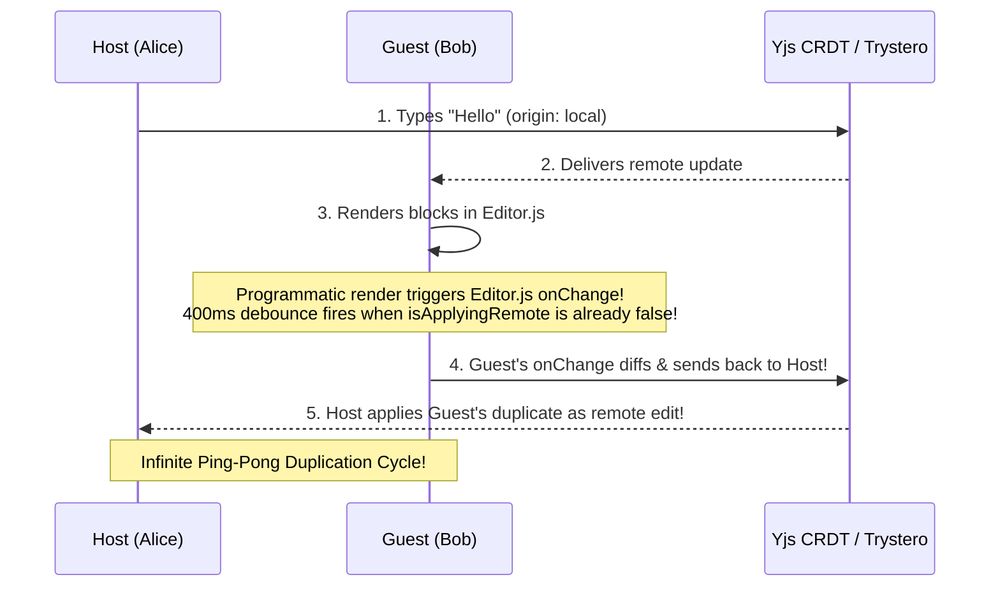
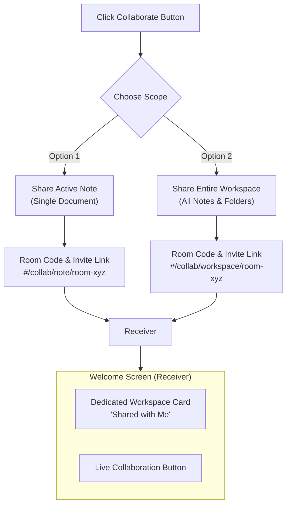

# KeepLocal Live Peer-to-Peer Collaboration Architecture

## 1. Executive Summary & Verification

### Can we show cursors & live highlights of collaborators when using Editor.js + Trystero?
**YES, ABSOLUTELY.** 

| Capability | Editor.js (Block Mode) | `<textarea>` (Plain Mode) | Implementation Mechanism |
| :--- | :--- | :--- | :--- |
| **Live Caret** | ✅ Yes (Sub-pixel precise) | ✅ Yes | Caret bounding client rect coordinates broadcasted via Trystero awareness; rendered in `#collabCursorOverlay`. |
| **Collaborator Name Tag** | ✅ Yes (Smooth floating flag) | ✅ Yes | Floating badge above colored caret showing collaborator's name (e.g. `Writer #8435`). |
| **Live Selection Highlight** | ✅ Yes (Multi-line highlight) | ✅ Yes | `range.getClientRects()` translucent boxes overlaying selected characters. |
| **Active Block Presence** | ✅ Yes (Notion / Craft style) | N/A (single block) | Left-edge accent border `.ce-block.collab-peer-active` in peer's color showing who is editing each block. |

---

## 2. Root Cause Analysis: Repeating & Appending Text Bug

### Why did text repeat or append when syncing?
This was a **classic CRDT echo/re-entrancy loop** caused by three compounding factors:



### The Solution: 3-Layer Echo Prevention
1. **User-Keystroke Gating (`isLocalUserEditing`)**:
   Document-level capturing listeners on `keydown` and `input`. Only edits initiated by **physical keyboard input or direct user paste** are dispatched to `handleLocalInput()`. Programmatic DOM renders (`render()`, `loadFile()`) never trigger a CRDT update.
2. **Post-Apply Cooldown Guard**:
   `isApplyingRemote` remains active for a 450ms cooldown window after remote updates are applied, ensuring any asynchronous Editor.js microtasks settle safely.
3. **Idempotent String Diffing**:
   If `yText.toString() === newContent`, `syncStringToYText()` immediately returns without opening a transaction or emitting update events.

---

## 3. Implemented Architecture (Diagram 1 & Diagram 2)



### A. Sharing Scopes (Diagram 1)
- **Share Active Note (`scope: "note"`)**:
  - Encodes `#/collab/note/<roomId>`.
  - Collaborators collaborate directly on the single open note.
  - Receiver creates or opens `Collab_<roomId>.md` without altering local files.
- **Share Entire Workspace (`scope: "workspace"`)**:
  - Encodes `#/collab/workspace/<roomId>?name=<wsName>`.
  - Syncs the entire workspace file tree via a dedicated `Y.Map("files")`.
  - Receiver gets a dedicated workspace created automatically: **"Shared: [Workspace Name]"**.

### B. Welcome Screen Integration (Diagram 2)
- **Dedicated Collaborative Workspace**:
  Workspaces with `ws.isCollab` are highlighted with a distinct **"Shared with Me"** badge, live peer indicators, and the collaborative users icon.
- **Direct Entry Points**:
  A prominent **Live Collaboration** action button is positioned directly on the Welcome screen next to "New Workspace", "Open Folder", and "Import ZIP".

---

## 4. Live Cursors & Selection Highlights Protocol

```json
{
  "peerId": "q8f92j1",
  "name": "Manisha",
  "color": "#3B82F6",
  "isHost": true,
  "cursor": {
    "fileId": "file_1795...",
    "mode": "block",
    "blockId": "b1a2c3d4",
    "x": 240,
    "y": 185,
    "h": 22,
    "rects": [
      { "x": 240, "y": 185, "w": 65, "h": 22 }
    ],
    "updatedAt": 1795255800000
  }
}
```

- **Throttling**: Cursor updates are throttled to 60ms to ensure smooth 60fps tracking without saturating WebRTC data channels.
- **Auto-Cleanup**: Cursors inactive for more than 30 seconds or associated with other documents automatically disappear from the current viewport.
